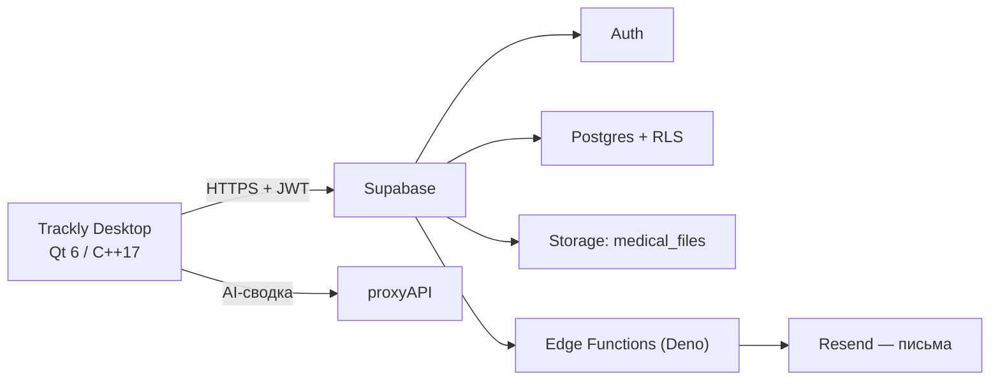

# Trackly Desktop

<div align="center">


**Дневник эпилепсии и контроля терапии — десктопное приложение на Qt 6 и Supabase**

[![Qt 6][badge-qt]][url-qt]
[![C++17][badge-cpp]][url-cpp]
[![Supabase][badge-supabase]][url-supabase]
[![Postgres + RLS][badge-postgres]][url-postgres]
[![Deno][badge-deno]][url-deno]
[![CMake][badge-cmake]][url-cmake]

[![Platform][badge-platform]][url-platform]
[![License][badge-license]][url-license]
[![Status][badge-status]][url-status]
[![Releases][badge-releases]][url-releases]

**[Возможности](#возможности)** · [Быстрый старт](#быстрый-старт) · [Настройка Supabase](#настройка-supabase) · [Безопасность](#безопасность) · [Лицензия](#лицензия)

</div>

---

## О проекте

**Trackly** — учебный проект: настольное приложение для людей с эпилепсией и их близких.
Оно помогает вести дневник приступов, контролировать приём препаратов, хранить результаты
обследований и видеть статистику по самочувствию.

Приложение — тонкий клиент: все данные живут в **Supabase** (Postgres + Auth + Storage),
а серверная логика вынесена в **Edge Functions** на Deno. Локально хранится только сессия
пользователя и пользовательские настройки.

> ⚠️ Это учебный проект. Готовых сборок и релизов нет — только исходный код.
> Приложение не является медицинским изделием и не заменяет консультацию врача.

## Возможности

| Раздел | Что умеет |
| --- | --- |
| **Главная** | Сводка по приступам и терапии, напоминания о приёме, календарь |
| **Приступы** | Журнал приступов: дата, длительность, тип, заметки |
| **Терапия** | Препараты, схемы приёма, отметки «принято / пропущено», остатки упаковки |
| **Обследования** | Записи об ЭЭГ/МРТ и вложения в Supabase Storage |
| **Аналитика** | Графики динамики и краткая AI-сводка по статистике |
| **Самочувствие** | Сон, настроение, возможные триггеры (стресс, недосып, пропуск дозы) |
| **Профиль** | Данные пользователя, экстренные контакты, выход из аккаунта |
| **Памятка при приступе** | Пошаговая инструкция и экстренное уведомление на e-mail |

Дополнительно:

- 🔐 Регистрация и вход через Supabase Auth, подтверждение e-mail 6-значным кодом (Resend)
- 🌗 Светлая и тёмная темы, авторежим по системной теме
- 🌍 Локализация: русский, беларуская, беларуская (лацінка), English
- 🖥️ Иконка в системном трее и нативные уведомления macOS
- 📄 Экспорт отчёта в PDF

## Стек

- **Клиент:** C++17, Qt 6 (Widgets, Network, Svg, Charts, LinguistTools), CMake
- **Бэкенд:** Supabase — Postgres + RLS, Auth, Storage, Edge Functions (Deno + TypeScript)
- **Почта:** Resend
- **AI-аналитика:** proxyAPI (OpenAI-совместимый шлюз), модель `gpt-4o-mini`

## Архитектура



## Структура репозитория

```
Trackly/
├── CMakeLists.txt              # сборка приложения
├── src/
│   ├── main.cpp                # точка входа, чтение конфигурации
│   ├── appcore.{h,cpp}         # сетевой слой, Auth, сессия, работа с Supabase
│   ├── mainwindow.{h,cpp}      # окно, сайдбар, топбар, авторизация, памятка
│   ├── styles.h                # QSS-темы
│   ├── utils.{h,cpp}           # конфигурация, форматирование, разбор ошибок
│   ├── exportreport.cpp        # экспорт отчёта в PDF
│   ├── tracklycalendar.*       # календарь
│   ├── widgets/                # переиспользуемые виджеты (тосты)
│   └── pages/                  # страницы: главная, приступы, терапия, обследования,
│                               # аналитика, самочувствие, профиль
├── resources/                  # иконки, шрифты, .qrc
├── translations/               # .ts-файлы (ru, be, be_Latn, en)
├── scripts/                    # упаковка дистрибутива (локально)
└── supabase/
    ├── functions/              # Edge Functions: send-verification-code, verify-code, emergency-email
    └── migrations/             # SQL-миграции
```

## Быстрый старт

### Требования

- Qt **6.5+** с модулями Widgets, Network, Svg, Charts, LinguistTools
- CMake **3.21+**
- Компилятор с поддержкой C++17 (clang / gcc / MSVC)
- Аккаунт Supabase с настроенным проектом (см. ниже)

### 1. Клонирование

```bash
git clone https://github.com/<your-login>/Trackly.git
cd Trackly
```

### 2. Настройка секретов

В коде нет ключей — приложение читает их из переменных окружения,
файла `trackly.local.json` (в `.gitignore`) или `QSettings`.

```bash
cp trackly.local.example.json trackly.local.json
# откройте файл и подставьте свои supabase_url и supabase_anon_key
```

Для запуска из терминала можно вместо этого экспортировать переменные
(имена — в `.env.example`; сам файл `.env` приложение не читает):

```bash
cp .env.example .env          # .env в .gitignore, коммитить нельзя
set -a && source .env && set +a
```

| Переменная | Обязательно | Назначение |
| --- | --- | --- |
| `TRACKLY_SUPABASE_URL` | да | Project URL из дашборда Supabase |
| `TRACKLY_SUPABASE_ANON_KEY` | да | Публичный anon / publishable ключ |
| `TRACKLY_AI_PROXY_KEY` | нет | Ключ proxyAPI для AI-аналитики |

### 3. Сборка и запуск

```bash
cmake -S . -B build/debug -DCMAKE_BUILD_TYPE=Debug
cmake --build build/debug

# macOS
open "build/debug/Trackly Desktop.app"

# Linux
./build/debug/TracklyDesktop

# Windows
build\debug\TracklyDesktop.exe
```

### 4. Упаковка (по желанию, локально)

```bash
./scripts/package.sh      # macOS: соберёт .dmg в dist/
scripts\package.bat        # Windows
```

Релизы на GitHub не публикуются — скрипты нужны только для локальной проверки.

## Настройка Supabase

### Таблицы

Приложение работает со следующими таблицами в схеме `public`:

`profiles`, `seizures`, `medications`, `medication_schedules`, `medication_logs`,
`examinations`, `attachments`, `wellbeing_entries`, `emergency_contacts`,
`verification_codes`.

Для вложений используется публичный бакет Storage `medical_files`.

> На всех таблицах обязательны **RLS-политики**: клиент ходит в базу с публичным
> anon-ключом, поэтому доступ к строкам ограничивается только политиками
> `auth.uid() = user_id`.

### Миграции

```bash
supabase link --project-ref <your-project-ref>
supabase db push
```

### Edge Functions

```bash
supabase functions deploy send-verification-code
supabase functions deploy verify-code
supabase functions deploy emergency-email

# секреты функций живут только на сервере
supabase secrets set RESEND_API_KEY=... SUPABASE_SERVICE_ROLE_KEY=...
```

Функции используют `SUPABASE_SERVICE_ROLE_KEY` и `RESEND_API_KEY` из окружения —
эти значения никогда не попадают в клиент и в репозиторий.

## Безопасность

- Все секреты вынесены из исходного кода в переменные окружения / `trackly.local.json` / `QSettings`.
- `.env`, `trackly.local.json` и `supabase/config.toml` перечислены в `.gitignore`.
- Ключ `service_role` применяется только внутри Edge Functions, в клиенте его нет.
- Перед публикацией репозитория история коммитов очищена от служебных файлов и ключей.

Если вы нашли уязвимость — см. [SECURITY.md](SECURITY.md).

## Лицензия

**Код закрыт для изменения.** Проект распространяется по проприетарной лицензии —
полный текст в [LICENSE.txt](LICENSE.txt).

- ✅ **Можно:** читать и изучать исходный код, клонировать репозиторий и запускать
  приложение для личного некоммерческого использования, делиться ссылкой на репозиторий.
- ❌ **Нельзя:** изменять и дорабатывать код, создавать производные работы и форки
  с изменениями, распространять и публиковать копии, использовать в коммерческих
  целях, удалять уведомления об авторских правах, использовать имя и логотип Trackly.

Разрешение на изменение кода выдаётся только письменно правообладателем
([@jaraslaukunin](https://github.com/jaraslaukunin)).

Проект учебный: готовых сборок и релизов нет, код опубликован для ознакомления.

<!-- ─── Бейджи (shields.io) ──────────────────────────────────────────────────── -->

[badge-qt]: https://img.shields.io/badge/Qt-6.5%2B-41CD52?style=for-the-badge&logo=qt&logoColor=white
[url-qt]: https://www.qt.io/
[badge-cpp]: https://img.shields.io/badge/C%2B%2B-17-00599C?style=for-the-badge&logo=cplusplus&logoColor=white
[url-cpp]: https://isocpp.org/
[badge-supabase]: https://img.shields.io/badge/backend-Supabase-3FCF8E?style=for-the-badge&logo=supabase&logoColor=white
[url-supabase]: https://supabase.com/
[badge-postgres]: https://img.shields.io/badge/DB-Postgres%20%2B%20RLS-4169E1?style=for-the-badge&logo=postgresql&logoColor=white
[url-postgres]: https://www.postgresql.org/
[badge-deno]: https://img.shields.io/badge/Edge%20Functions-Deno-000000?style=for-the-badge&logo=deno&logoColor=white
[url-deno]: https://deno.com/
[badge-cmake]: https://img.shields.io/badge/CMake-3.21%2B-064F8C?style=for-the-badge&logo=cmake&logoColor=white
[url-cmake]: https://cmake.org/
[badge-platform]: https://img.shields.io/badge/platform-macOS%20%7C%20Windows%20%7C%20Linux-555555?style=for-the-badge&logo=linux&logoColor=white
[url-platform]: #быстрый-старт
[badge-license]: https://img.shields.io/badge/license-proprietary-c1121f?style=for-the-badge&logo=opensourceinitiative&logoColor=white
[url-license]: LICENSE.txt
[badge-status]: https://img.shields.io/badge/status-educational%20project-blueviolet?style=for-the-badge
[url-status]: #о-проекте
[badge-releases]: https://img.shields.io/badge/releases-not%20published-lightgrey?style=for-the-badge&logo=github&logoColor=white
[url-releases]: #лицензия
