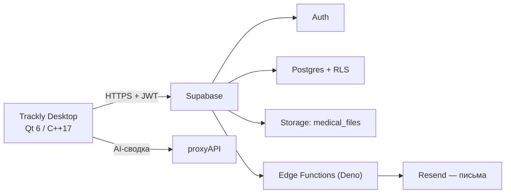

<div align="center">


# Trackly Desktop

**Дневник эпилепсии и контроля терапии: приступы, препараты, обследования и аналитика — Qt 6 и Supabase.**

[](https://isocpp.org/)
[](https://www.qt.io/)
[](https://supabase.com/)
[](https://www.postgresql.org/)
[](https://deno.com/)
[](https://cmake.org/)

[](LICENSE.txt)
[](https://github.com/jaraslaukunin/Trackly)

**[Возможности](#возможности)** · [Технологии](#технологии) · [Архитектура](#архитектура) · [Быстрый старт](#быстрый-старт) · [Настройка Supabase](#настройка-supabase) · [Безопасность](#безопасность) · [Лицензия](#лицензия)

</div>

---

## О проекте

**Trackly** — настольное приложение для людей с эпилепсией и их близких. Оно помогает вести дневник
приступов, контролировать приём препаратов, хранить результаты обследований и видеть динамику
самочувствия в виде графиков.

Приложение — тонкий клиент: данные живут в **Supabase** (Postgres + Auth + Storage), серверная
логика вынесена в **Edge Functions** на Deno, а локально остаются только сессия пользователя,
настройки интерфейса и файл `trackly.local.json` с ключами. Такой выбор позволяет не тащить
в десктоп собственный сервер и не хранить медицинские данные на машине пользователя.

> ⚠️ Это учебный проект. Готовых сборок и релизов нет — только исходный код.
> Приложение не является медицинским изделием, не ставит диагнозы и не заменяет консультацию врача.

## Возможности

| Раздел | Что умеет |
| --- | --- |
| **Главная** | Приветствие и сводка дня, календарь, карточки с ближайшими приёмами, препаратами и приступами |
| **Приступы** | Журнал с датой и временем начала, местом, типом (8 вариантов), триггерами, состоянием после, тяжестью 1–3 и заметками; редактирование, удаление, «заполнить как шаблон» |
| **Терапия** | Препарат с брендом, МНН, силой таблетки и дозой; режим «постоянная / курсами / по необходимости»; времена приёмов, остаток упаковки в таблетках, отметки «принято / пропущено», приём по необходимости, перенос времени и отмена отметки |
| **Обследования** | Тип (МРТ, КТ, ЭЭГ, ЭКГ, рентген, СМАД, холтер ЭЭГ/ЭКГ, приём врача) и подтип, дата, заметка; файл загружается в Supabase Storage, список разделён на прошедшие и запланированные |
| **Аналитика** | Периоды 7 / 30 / 90 дней, всё время или свой диапазон; графики «средний настрой по дням», «принято / запланировано», «приступы по дням»; текстовые выводы и AI-сводка |
| **Самочувствие** | Отметки «утро / вечер»: настроение, часы и качество сна, триггеры (недосып, стресс, пропуск лекарств и ещё 7) и заметка; история записей |
| **Профиль** | Имя, статус, «о себе», дата рождения, пол, телефон, адрес, экстренный контакт и лечащий врач, аватар с кадрированием и поворотом |
| **Памятка при приступе** | Пошаговая инструкция, кнопка экстренного звонка и отправка уведомления на e-mail через Edge Function |
| **Отчёт** | PDF за выбранный период с блоками «Лекарства и приёмы», «Приступы», «Самочувствие», «Обследования», «Графики» и таблицей по дням |

Дополнительно:

- 🔐 Вход через Supabase Auth с подтверждением e-mail 6-значным кодом (Edge Functions + Resend)
- ⏰ Напоминания о приёме препарата и о записи самочувствия — иконка в системном трее и нативные уведомления macOS
- 🌗 Светлая, тёмная и автоматическая тема (по системной), выбор запоминается в `QSettings`
- 🌍 Локализация: русский, беларуская, беларуская (лацінка), English — файлы `translations/*.ts` собираются `qt_add_translations`
- 🖥️ Сборка под macOS (bundle + `.icns`), Windows (`.ico`) и Linux

## Технологии

- **C++17** — клиент без сторонних фреймворков.
- **Qt 6** — Widgets (интерфейс), Network (HTTP-клиент к Supabase), Svg (иконки), Charts (графики), LinguistTools (переводы).
- **CMake 3.21+** — сборка, `qt_standard_project_setup` с языками ru/be/be_Latn/en.
- **Supabase** — Postgres с RLS, Auth, Storage для файлов обследований, Edge Functions на Deno + TypeScript.
- **Resend** — отправка писем с кодом подтверждения и экстренных уведомлений из Edge Functions.
- **proxyAPI** — OpenAI-совместимый шлюз для AI-сводки, модель `gpt-4o-mini`.

## Архитектура



Весь сетевой слой собран в `src/appcore.cpp`: `QNetworkAccessManager`, заголовки авторизации,
хранение access/refresh-токенов, автоматическое обновление сессии по истечении срока и кэш
загруженных сущностей. Интерфейс подписан на сигналы `AppCore` (`seizuresReady`,
`medicationsReady`, `aiAnalyticsReady` и другие) и не ходит в сеть напрямую.

## Структура проекта

```text
Trackly/
├── CMakeLists.txt              # цель TracklyDesktop, Qt 6, переводы, опция TRACKLY_DEPLOY
├── src/
│   ├── main.cpp                # точка входа, чтение конфигурации, тема и язык
│   ├── appcore.{h,cpp}         # сетевой слой: Auth, сессия, REST/Storage/Edge Functions, AI
│   ├── appcore_mac.mm          # нативные уведомления macOS
│   ├── mainwindow.{h,cpp}      # окно, сайдбар, топбар, оверлеи авторизации и памятки
│   ├── authdialog.*            # диалог входа (в текущем UI — оверлей в MainWindow)
│   ├── styles.h                # QSS-темы
│   ├── utils.{h,cpp}           # конфигурация, форматирование, разбор ошибок
│   ├── exportreport.cpp        # PDF-отчёт за период
│   ├── tracklycalendar.*       # календарь
│   ├── examattachmentdroparea.* # drag&drop для файлов обследований
│   ├── widgets/toastwidget.*   # всплывающие уведомления
│   └── pages/                  # dashboard, seizures, medications, examinations,
│                               # analytics, triggers, profile
├── resources/                  # иконки, шрифты, logo, resources.qrc
├── translations/               # trackly_ru/be/be_Latn/en.ts
├── scripts/                    # package.sh (DMG), package.bat (NSIS), publish-to-github.sh
├── supabase/
│   ├── functions/              # send-verification-code, verify-code, emergency-email
│   └── migrations/             # SQL-миграции (verification_codes)
├── SECURITY.md                 # политика безопасности
├── trackly.local.example.json  # шаблон локальных ключей
└── .env.example                # имена переменных окружения
```

## Быстрый старт

### Требования

- Qt **6** с модулями Widgets, Network, Svg, Charts, LinguistTools (проект собран на Qt 6.10.2);
- CMake **3.21+**, компилятор с поддержкой C++17 (clang / gcc / MSVC);
- проект Supabase с применёнными миграциями (см. [Настройка Supabase](#настройка-supabase)).

### 1. Клонирование

```bash
git clone https://github.com/jaraslaukunin/Trackly.git
cd Trackly
```

### 2. Настройка секретов

В коде нет ключей: приложение ищет значения в переменных окружения, затем в
`trackly.local.json` рядом с проектом, затем в `QSettings`.

```bash
cp trackly.local.example.json trackly.local.json
# подставьте свои supabase_url, supabase_anon_key и (по желанию) ai_proxy_key
```

Для запуска из терминала можно использовать переменные окружения — имена перечислены в
`.env.example` (сам файл `.env` приложение не читает, он нужен как шпаргалка и для CI):

```bash
cp .env.example .env        # .env в .gitignore, коммитить нельзя
set -a && source .env && set +a
```

| Переменная | Обязательно | Назначение |
| --- | --- | --- |
| `TRACKLY_SUPABASE_URL` | да | Project URL из дашборда Supabase |
| `TRACKLY_SUPABASE_ANON_KEY` | да | Публичный anon / publishable ключ |
| `TRACKLY_AI_PROXY_KEY` | нет | Ключ proxyAPI для AI-сводки; без него кнопка вернёт ошибку |

### 3. Сборка и запуск

```bash
cmake -S . -B build/debug -DCMAKE_BUILD_TYPE=Debug
cmake --build build/debug

# macOS: приложение собирается как bundle "Trackly Desktop"
open "build/debug/Trackly Desktop.app"

# Linux (имя файла задано через OUTPUT_NAME, поэтому с пробелом)
./build/debug/"Trackly Desktop"

# Windows
build\debug\Trackly Desktop.exe
```

Если CMake не находит Qt, добавьте `-DCMAKE_PREFIX_PATH=/path/to/Qt/6.x.x/gcc_64`.

### 4. Упаковка (по желанию, локально)

```bash
./scripts/package.sh     # macOS: Release + TRACKLY_DEPLOY=ON + macdeployqt → dist/TracklyDesktop-0.1.0.dmg
scripts\package.bat      # Windows: Release + windeployqt + NSIS-установщик
```

Релизы на GitHub не публикуются: скрипты нужны только для локальной проверки дистрибутива.

## Настройка Supabase

### Таблицы

Клиент работает с таблицами схемы `public`:

`profiles`, `seizures`, `medications`, `medication_schedules`, `medication_logs`,
`examinations`, `attachments`, `wellbeing_entries`, `emergency_contacts`,
`verification_codes`.

Файлы обследований лежат в бакете Storage `medical_files`; публичные ссылки строятся через
`/storage/v1/object/public/medical_files/`.

> На всех таблицах обязательны **RLS-политики**: клиент ходит в базу с публичным anon-ключом,
> поэтому доступ к строкам ограничивается только политиками вида `auth.uid() = user_id`.

### Миграции

```bash
supabase link --project-ref <your-project-ref>
supabase db push
```

### Edge Functions

```bash
supabase functions deploy send-verification-code
supabase functions deploy verify-code
supabase functions deploy emergency-email

# секреты функций живут только на сервере
supabase secrets set RESEND_API_KEY=... SUPABASE_SERVICE_ROLE_KEY=...
```

Функции читают `SUPABASE_SERVICE_ROLE_KEY` и `RESEND_API_KEY` из окружения — эти значения
никогда не попадают в клиент и в репозиторий.

## Безопасность

- Все секреты вынесены из исходного кода в переменные окружения / `trackly.local.json` / `QSettings`.
- `.env`, `trackly.local.json` и `supabase/config.toml` перечислены в `.gitignore`.
- Ключ `service_role` применяется только внутри Edge Functions, в клиенте его нет.
- Сессия (access/refresh-токены) хранится локально в `QSettings`, обновляется по сроку действия.
- Перед публикацией репозитория история коммитов очищена от служебных файлов и ключей.

Если вы нашли уязвимость — не создавайте публичный issue, а напишите владельцу:
подробности в [SECURITY.md](SECURITY.md).

## Лицензия

**Код закрыт для изменения.** Проект распространяется по проприетарной лицензии —
полный текст в [LICENSE.txt](LICENSE.txt).

- ✅ **Можно:** читать и изучать исходный код, клонировать репозиторий и запускать приложение
  для личного некоммерческого использования, делиться ссылкой на репозиторий.
- ❌ **Нельзя:** изменять и дорабатывать код, создавать производные работы и форки с изменениями,
  распространять и публиковать копии, использовать в коммерческих целях, удалять уведомления
  об авторских правах, использовать имя и логотип Trackly.

Разрешение на изменение кода выдаётся только письменно правообладателем
([@jaraslaukunin](https://github.com/jaraslaukunin)). Проект учебный: готовых сборок
и релизов нет, код опубликован для ознакомления.

---

<div align="center">

**[github.com/jaraslaukunin/Trackly](https://github.com/jaraslaukunin/Trackly)** — поставьте ⭐, если проект оказался полезен.

</div>
